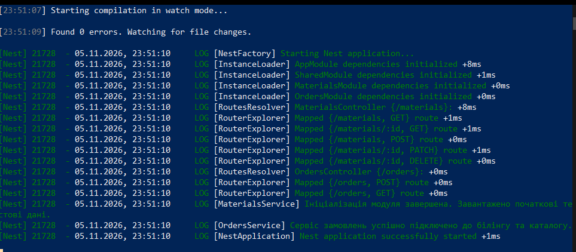
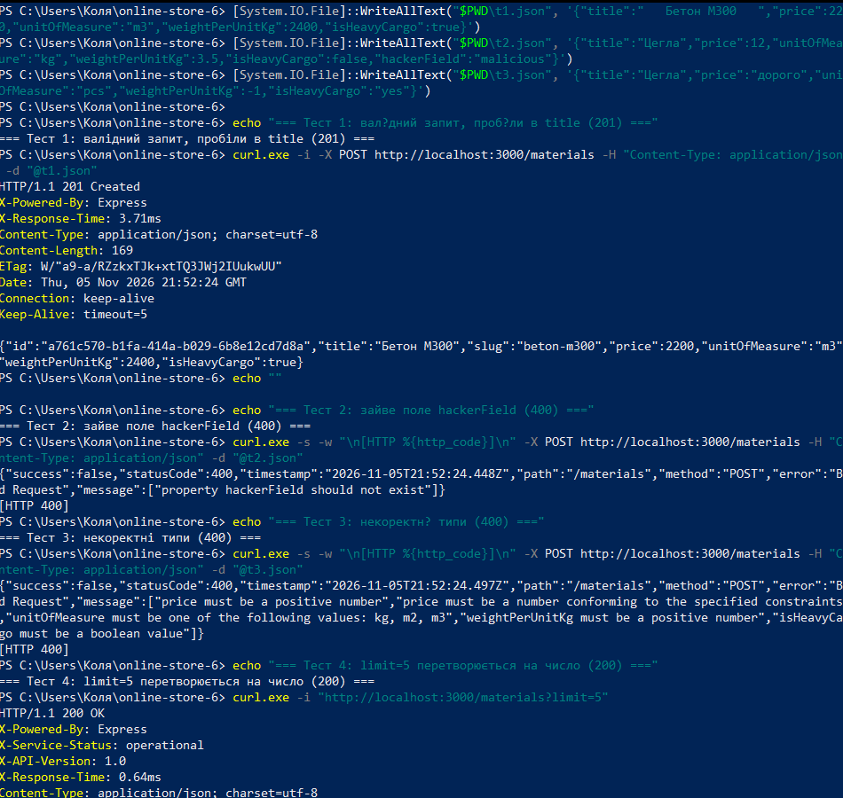
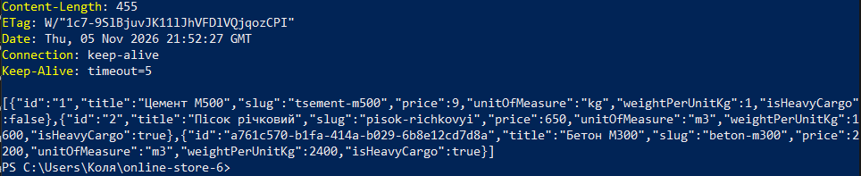
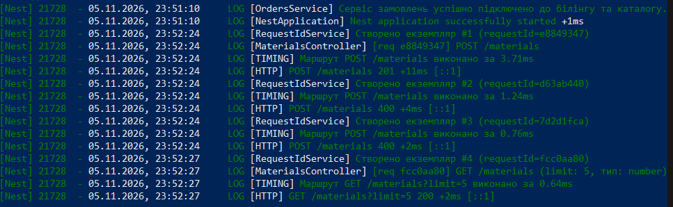

# Практична робота № 6

**Тема:** Валідація вхідних даних та обробка запитів у NestJS (Request Pipeline)

**Виконав:** Дурицький М.М., група КН-43

**Варіант:** 6 (будівельні матеріали, ресурс `/materials`)

## Опис

До REST API каталогу будівельних матеріалів (практичні роботи № 4 і № 5) додано захист та обробку запитів на всіх етапах конвеєра NestJS:

- валідація DTO через `class-validator` та глобальний `ValidationPipe`;
- власний пайп `TrimPipe` для очищення рядків;
- `HttpLoggingMiddleware` для логування запитів;
- глобальний `GlobalExceptionFilter` з єдиним форматом помилок;
- глобальний `TimingInterceptor`, що додає заголовок `X-Response-Time`.

Правила валідації за варіантом 6:

| Поле | Правила |
|------|---------|
| `title` | `@IsString()`, `@IsNotEmpty()`, `@MaxLength(100)` |
| `price` | `@IsNumber()`, `@IsPositive()` |
| `unitOfMeasure` | `@IsEnum(...)`, допустимі значення `kg`, `m2`, `m3` |
| `weightPerUnitKg` | `@IsNumber()`, `@IsPositive()` |
| `isHeavyCargo` | `@IsBoolean()` |

## Середовище

- Windows, PowerShell
- Node.js v22.23.3, npm
- NestJS 12 (ESM), `class-validator`, `class-transformer`
- Visual Studio Code + REST Client (для `requests.http`)

## Структура змін

```
src/
├── main.ts                                   - глобальні пайпи, фільтр, інтерцептор
├── app.module.ts                             - реєстрація middleware (NestModule.configure)
├── common/
│   ├── pipes/trim.pipe.ts                    - TrimPipe
│   ├── middleware/http-logger.middleware.ts  - HttpLoggingMiddleware
│   ├── filters/http-exception.filter.ts      - GlobalExceptionFilter
│   └── interceptors/timing.interceptor.ts    - TimingInterceptor
├── materials/dto/
│   ├── create-material.dto.ts                - правила валідації
│   ├── update-material.dto.ts                - ті самі правила + @IsOptional()
│   └── query-materials.dto.ts                - search, limit (перетворення в число)
└── orders/dto/create-order.dto.ts            - валідація замовлення
```

## Запуск

```powershell
npm install --legacy-peer-deps
npm run start:dev
```

Запити виконуються з файлу `requests.http` (REST Client у VS Code) на `http://localhost:3000`.

---

## Рівень 1. Валідація DTO та глобальний ValidationPipe

**Встановлення пакетів:**

```powershell
npm install class-validator class-transformer --legacy-peer-deps
```

**DTO** (`create-material.dto.ts`) описано декораторами `class-validator`:

```ts
export class CreateMaterialDto {
  @IsString()
  @IsNotEmpty()
  @MaxLength(100)
  readonly title: string;

  @IsNumber()
  @IsPositive()
  readonly price: number;

  @IsEnum(UnitOfMeasures)
  readonly unitOfMeasure: UnitOfMeasure;

  @IsNumber()
  @IsPositive()
  readonly weightPerUnitKg: number;

  @IsBoolean()
  readonly isHeavyCargo: boolean;
}
```

`UpdateMaterialDto` має ті самі правила, але перед кожним полем додано `@IsOptional()`, тому `PATCH` приймає будь-яку підмножину полів.

Для `@IsEnum` замість масиву `['kg', 'm2', 'm3']` використано об'єкт-перерахування `UnitOfMeasures = { Kg: 'kg', M2: 'm2', M3: 'm3' } as const`. Правило працює однаково, але з масивом `class-validator` виводить у повідомленні порожній список допустимих значень, а з об'єктом `must be one of the following values: kg, m2, m3`.

**Глобальний `ValidationPipe`** у `main.ts`:

```ts
app.useGlobalPipes(
  new TrimPipe(),
  new ValidationPipe({
    whitelist: true,            // прибирає властивості без декораторів
    forbidNonWhitelisted: true, // замість мовчазного прибирання повертає 400
    transform: true,            // перетворює дані на екземпляри DTO / типи
  }),
);
```

Оскільки пайп глобальний і діє на всі DTO, декоратори `class-validator` додано і до `CreateOrderDto` (інакше `forbidNonWhitelisted` відхиляв би всі його поля). Ручну перевірку з сервісів прибрано: тепер вона виконується на рівні DTO.

**Query-параметри** описано окремим класом `QueryMaterialsDto` (`search`, `limit`). Для `limit` використано `@Type(() => Number)` з `class-transformer`, `@IsInt()` та `@Min(1)`, тому рядок `"5"` з адреси стає числом `5`.

---

## Рівень 2. TrimPipe та Middleware

**`TrimPipe`** (`implements PipeTransform`): рекурсивно обходить рядки, масиви та прості об'єкти й викликає `.trim()`. Інші значення повертає без змін. Пайп зареєстровано першим, тому `ValidationPipe` отримує вже очищені дані.

```ts
transform(value: unknown, _metadata: ArgumentMetadata): unknown {
  return trimDeep(value);
}
```

**`HttpLoggingMiddleware`** (`implements NestMiddleware`): у `use(req, res, next)` запам'ятовує час початку, а в події `res.on('finish', ...)` виводить рядок у форматі `[HTTP] METHOD URL STATUS +Nms [IP]`. Підключено в `AppModule` через `NestModule.configure()`:

```ts
configure(consumer: MiddlewareConsumer): void {
  consumer.apply(HttpLoggingMiddleware).forRoutes('*');
}
```

---

## Рівень 3. Exception Filter та Interceptor

**`GlobalExceptionFilter`** (`@Catch(HttpException)`) перехоплює всі HTTP-виключення (у тому числі помилки валідації та `NotFoundException`) і повертає єдиний формат:

```json
{
  "success": false,
  "statusCode": 400,
  "timestamp": "2026-11-05T21:52:24.448Z",
  "path": "/materials",
  "method": "POST",
  "error": "Bad Request",
  "message": ["property hackerField should not exist"]
}
```

Через `host.switchToHttp()` фільтр отримує `Request` та `Response` Express (`getRequest()`, `getResponse()`).

**`TimingInterceptor`** (`implements NestInterceptor`) фіксує час початку, а після виконання через оператор `tap()` встановлює заголовок `X-Response-Time` і пише в лог `[TIMING] Маршрут METHOD URL виконано за Nms`. `tap()` лише спостерігає за потоком, тому тіло відповіді не змінюється. Колбек додано і для гілки помилки (`tap({ next, error })`), тому заголовок є також у відповідях зі статусом 400.

Глобальна реєстрація у `main.ts`:

```ts
app.useGlobalFilters(new GlobalExceptionFilter());
app.useGlobalInterceptors(new TimingInterceptor());
```

---

## Результати тестування

### Запуск сервера

Компіляція без помилок (`Found 0 errors`), маршрути змаплені, сервер запущено.



### Тести з умови





| Тест | Запит | Результат |
|------|-------|-----------|
| 1. Валідний | `POST /materials`, `title` із пробілами по краях | `201 Created`, `title` збережено як `Бетон М300` (TrimPipe), згенеровано `slug: beton-m300`, у відповіді заголовок `X-Response-Time` |
| 2. Зайве поле | `POST /materials` з `hackerField` | `400 Bad Request`, `property hackerField should not exist` |
| 3. Некоректні типи | `price: "дорого"`, `unitOfMeasure: "pcs"`, `weightPerUnitKg: -1`, `isHeavyCargo: "yes"` | `400`, список помилок по кожному полю, зокрема `unitOfMeasure must be one of the following values: kg, m2, m3` |
| 4. Трансформація query | `GET /materials?limit=5` | `200 OK`, заголовки `X-Response-Time`, `X-API-Version`; у логах контролера `limit: 5, тип: number` |

### Логи middleware та interceptor

На кожен запит у консолі сервера з'являються два рядки: `[TIMING]` від інтерцептора та `[HTTP]` від middleware з методом, адресою, статусом і часом. Видно статуси 201, 400, 400 та 200, а також те, що `limit` у контролері має тип `number`.



---

## Відповіді на контрольні питання

**1. Черговість проходження запиту крізь Request Pipeline.**
Запит приходить на HTTP-сервер (Express), потім виконуються: Middleware (глобальні, далі модульні), Guards, Interceptors (код до виклику обробника), Pipes (трансформація та валідація аргументів), сам обробник контролера, який викликає сервіс. Після цього відповідь повертається назад через Interceptors (код після обробника, наприклад `tap()`/`map()`). Якщо на будь-якому етапі після middleware виникло виключення, його перехоплюють Exception Filters, і саме фільтр формує відповідь клієнту.

**2. Опції `whitelist` та `forbidNonWhitelisted`.**
`whitelist: true` вилучає з вхідного об'єкта всі властивості, у яких немає декораторів валідації. `forbidNonWhitelisted: true` додатково замість мовчазного вилучення повертає помилку `400` з текстом `property X should not exist`. Разом вони захищають від Mass Assignment (over-posting): коли зловмисник додає до тіла запиту зайві поля (`isAdmin`, `id`, `role`), сподіваючись, що вони потраплять у модель.

**3. Що робить `transform: true`?**
Опція перетворює звичайний JSON-об'єкт на екземпляр класу DTO (через `class-transformer`) і перетворює примітивні значення з `@Param()` та `@Query()` на тип, вказаний у параметрі. Без неї пайп лише перевіряє дані й повертає оригінальний об'єкт. Значення з `@Query()` та `@Param()` лишаються рядками, бо адреса запиту це текст, і Nest не знає, який тип очікує обробник, доки його не вказано. У роботі для `limit` потрібен ще й `@Type(() => Number)`, бо в DTO-класі автоматичного перетворення за типом немає.

**4. Middleware проти Interceptor.**
Middleware працює на рівні Express до маршрутизації, бачить лише `req`, `res`, `next` і нічого не знає про обробник, який виконається. Interceptor має `ExecutionContext` (знає контролер і метод), обгортає виклик обробника за допомогою RxJS і може виконати дії до та після нього, змінити відповідь, виміряти час, закешувати результат. Middleware обирають для низькорівневих завдань (логування запитів, CORS, парсинг cookie), Interceptor коли потрібен контекст обробника або обробка вихідної відповіді.

**5. Інтерфейс `PipeTransform`.**
Це контракт для пайпів: клас реалізує метод `transform(value, metadata)`, який перетворює або перевіряє аргумент і повертає значення (або кидає виключення). `value` це поточне значення аргументу, `metadata` це `ArgumentMetadata` з полями `type` (`body`, `query`, `param` або `custom`), `metatype` (клас/тип параметра) та `data` (ім'я параметра в декораторі).

**6. Декоратор `@Catch(HttpException)` та `host.switchToHttp()`.**
`@Catch(HttpException)` прив'язує фільтр до виключень цього класу та його нащадків (`NotFoundException`, `BadRequestException` тощо). Метод `catch(exception, host)` отримує виключення та `ArgumentsHost`. Виклик `host.switchToHttp()` повертає об'єкт для HTTP-контексту, у якому `getRequest<Request>()` та `getResponse<Response>()` дають об'єкти Express, і далі відповідь формується через `response.status(...).json(...)`.

**7. `ValidationPipe`, `class-transformer` та `@ValidateNested()`.**
`ValidationPipe` спочатку перетворює вхідний JSON на екземпляр класу через `plainToInstance` з `class-transformer`, а потім валідує його через `class-validator`. Для вкладених об'єктів у полі ставлять `@ValidateNested()` (для масивів `@ValidateNested({ each: true })`) і `@Type(() => ChildDto)`. Декоратор `@Type` підказує `class-transformer`, у який клас перетворити вкладений об'єкт; без нього вкладене значення лишається звичайним об'єктом, і декоратори вкладеного DTO не спрацьовують.

**8. Оператор RxJS `tap()` в інтерцепторі.**
`tap()` призначений для побічних ефектів: він отримує кожне значення потоку, виконує задану дію (лог, вимір часу, встановлення заголовка) і передає те саме значення далі без змін. Тому в `next.handle().pipe(tap(...))` можна додати поведінку до вихідної відповіді, не чіпаючи її тіла, на відміну від оператора `map()`, який змінює дані.

---

## Висновки

Налаштовано глобальну валідацію вхідних даних (`ValidationPipe` із `whitelist`, `forbidNonWhitelisted`, `transform`) та описано правила DTO за варіантом 6 через `class-validator`. Додано власний `TrimPipe`, `HttpLoggingMiddleware`, `GlobalExceptionFilter` з єдиним форматом помилок та `TimingInterceptor`, що додає заголовок `X-Response-Time`. Усі чотири тести з умови пройдені: валідний запит створено з очищеною назвою, зайве поле та некоректні типи відхилені з повідомленнями `400`, `limit` у query перетворюється на число. Результати підтверджено запитами й логами сервера.
